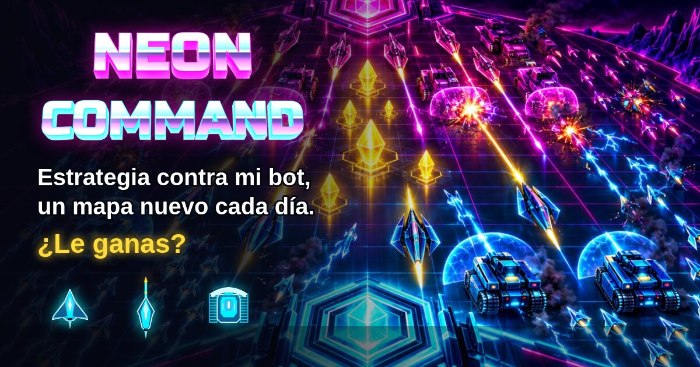

# Neon Command

**Estrategia en tiempo real contra un bot, con un mapa nuevo cada día, igual para todos.** Juego de navegador de código
abierto, hecho con JavaScript, CSS y HTML puros: sin frameworks, sin paso de compilación, sin registro.

- **Jugar:** [games.johnandrestrujillo.com/play/neon-command](https://games.johnandrestrujillo.com/play/neon-command)
- **Controles:** compra unidades con los botones de abajo, elige un grupo y toca el mapa para mandarlo. En teclado:
  1, 2 y 3 compran; Q, W, E y R eligen el grupo; A ataca el núcleo del bot, S toma el cristal más cercano y D vuelve a
  casa; B activa la compra automática; M apaga o enciende el sonido; Esc o P pausan.

*English: a small real-time strategy game against a bot, with a new map every day. Open-source browser game in plain
JavaScript. Add `?lang=en` for English.*



## Cómo se juega

Tu núcleo está abajo y el del bot arriba. La energía llega sola, y más rápido por cada cristal que controlas: un cristal
pasa a tu lado cuando solo tus unidades están a su alrededor unos segundos. Tres unidades se ganan entre sí en círculo:

| Unidad | Costo | Le gana a |
|---|---|---|
| Chispa (rápida) | 40 | Lanza |
| Lanza (largo alcance) | 60 | Escudo |
| Escudo (resistente) | 80 | Chispa |

Las unidades pelean con lo que encuentran en el camino. Los núcleos se defienden un poco y resisten: un asedio toma su
tiempo. Gana quien destruya el núcleo del otro.

**Para que sea justo** (cómo lo hacen otros juegos de estrategia):

- **Tres niveles.** Fácil, Normal y Difícil cambian la energía del bot, lo rápido que piensa y contraataca, cuánto espera
  antes de atacar y cuántas unidades se permite tener de más. El puntaje se multiplica (×0,6, ×1, ×1,4), así que los
  resultados de distintos niveles se pueden comparar. La primera vez se empieza en Fácil; el juego recuerda la elección.
- **Nadie empieza vacío:** cada lado arranca con dos Chispas y una Lanza.
- **Remontada:** quien tiene menos cristales recibe 2 de energía por segundo por cada cristal de diferencia.
- **Muerte súbita:** desde el minuto 8 los núcleos pierden su blindaje y desde el 10 reciben el doble; no hay empates
  eternos.
- **Dominio:** quien tiene todos los cristales menos uno, con el otro sin ninguno, deja al núcleo rival sin blindaje y
  con la torreta a la mitad de velocidad.
- **Núcleo roto:** por debajo del 30 % un núcleo pierde el blindaje y la torreta, así que el final llega en segundos.
- **Segundo aire** (Fácil y Normal, una vez): cuando tu núcleo se rompe, suelta una onda contra los atacantes y te da
  150 de energía.
- **Refuerzos seguros:** las unidades nuevas esperan frente a tu núcleo hasta que haya un grupo al que sumarse.
- **Rendirse:** en la pausa, para no esperar una derrota que ya se ve venir.

Las partidas duran de 2 a 10 minutos.

## Arte

Las unidades son vectores en `js/unit-art.js`, calcados de referencias aprobadas, con cada pieza en su capa (cuerpo,
núcleo, lanza, escudo, orugas, llama) para animarla. El juego las dibuja desde ahí y `node tools/unit_svgs.js` escribe los
SVG en `img/units/`. El ícono sale de la Chispa (`node tools/favicon.js`, y los PNG desde `tools/icons.html`). La vista
previa al compartir (`og.jpg`) se arma en `tools/og-units.html` con un navegador.

## El reto del día

La fecha decide el mapa (dónde están los cristales, siempre en espejo para que sea justo) y el estilo del bot: su mezcla de
unidades, cuántas junta antes de atacar y qué tan seguido responde a lo que tú construyes. Todos enfrentan la misma
batalla ese día. Ganar da 1.000 puntos más un bono por rapidez y por el núcleo que conserves; perder da puntos por las
unidades derribadas, el daño al núcleo enemigo y los cristales tomados. Detalles en [docs/DAILY.md](docs/DAILY.md).

## Probarlo en tu máquina

```
python3 -m http.server 8000
```

y abre <http://localhost:8000>. Para jugar la batalla de otro día: `?debug=true&day=2026-11-30`.
Pruebas (Playwright): `tests/smoke.py`; batallas aceleradas con un jugador de prueba: `tests/battles.py`.

## Créditos y licencia

Código original de John Andrés Trujillo, publicado con [licencia MIT](LICENSE). Un juego propio del género de estrategia
en tiempo real: sus unidades, reglas y aspecto no copian ningún juego existente. El reto diario, la forma de compartir y la
medición vienen de sus juegos hermanos [Neon Raiders](https://github.com/jatezzz/neon-raiders),
[Neon Bricks](https://github.com/jatezzz/neon-bricks) y [Neon Stack](https://github.com/jatezzz/neon-stack). Este proyecto no
está afiliado ni respaldado por los dueños de ningún juego ni de sus marcas.
